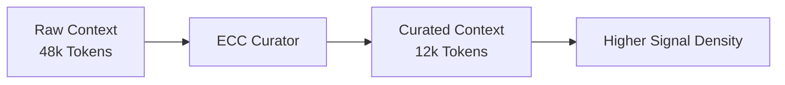

# ECC Curator

> Context governance for AI agents.
>
> Preserve signal. Compress redundancy. Eliminate noise.

ECC Curator is a context governance engine that helps AI agents operate within finite context windows.

Instead of continuously accumulating context until a model reaches its token limit, ECC Curator manages working memory by deciding what deserves attention.

For every piece of information:

```text
KEEP
COMPRESS
TRANSFORM
DROP
```

The goal is simple:

> Increase reasoning value per token.

---

## The Problem

Modern AI agents accumulate:

- conversation history
- plans
- memories
- terminal output
- test results
- code diffs
- retrieved documents

As context grows, information density decreases.

Eventually agents hit:

- max token limits
- context exhaustion
- degraded reasoning quality
- unnecessary model escalation

The challenge is no longer generating information.

The challenge is deciding what deserves attention.

---

## The ECC Curation Principle

ECC Curator is based on a simple observation:

> As context grows, information density decreases. Beyond a certain threshold, additional context contributes more noise than reasoning value.

Every token spent on low-value information is a token unavailable for reasoning.

ECC Curator continuously curates context to maximise information density within a fixed token budget.

---

## Compression Is Not Governance

Many excellent projects optimise tokens:

| Project | Focus |
|----------|----------|
| [RTK](https://github.com/rtk-ai/rtk) | Tool output compression |
| [Caveman](https://github.com/JuliusBrussee/caveman) | Natural language compression |
| [LLMLingua](https://github.com/microsoft/LLMLingua) | Prompt compression |
| [Troglodita](https://github.com/leninejunior/troglodita) | Token reduction |

ECC Curator operates at a different layer.

Rather than asking:

> "How can this be smaller?"

It asks:

> "Should this information remain in the context at all?"

Governance happens before optimisation.

Compression is only one possible strategy.

---

## Why ECC Curator Exists



---

## Vision

```text
Context Inventory
        │
        ▼
   Classify
        │
        ▼
     Score
        │
        ▼
     Budget
        │
        ▼
Choose Strategy
        │
 ┌──────┼──────┐
 ▼      ▼      ▼
Keep Compress Drop
```

ECC Curator acts as a portfolio manager for context.

Every piece of information consumes budget.

Every piece of information must justify its existence.

---

## Documentation

- [Architecture](docs/ARCHITECTURE.md)
- [Roadmap](docs/ROADMAP.md)
- [Decision Model](docs/DECISIONS.md)
- [Context Model](docs/CONTEXT_MODEL.md)
- [Jev Integration](docs/JEV_INTEGRATION.md)
- [Evaluation Framework](docs/EVALUATION.md)

---

## Status

🚧 Early Design Phase

The future of autonomous agents is not more context.

The future of autonomous agents is better context.
