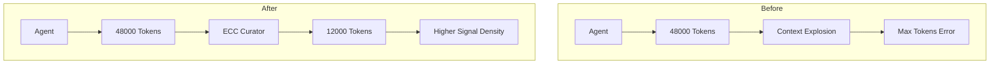
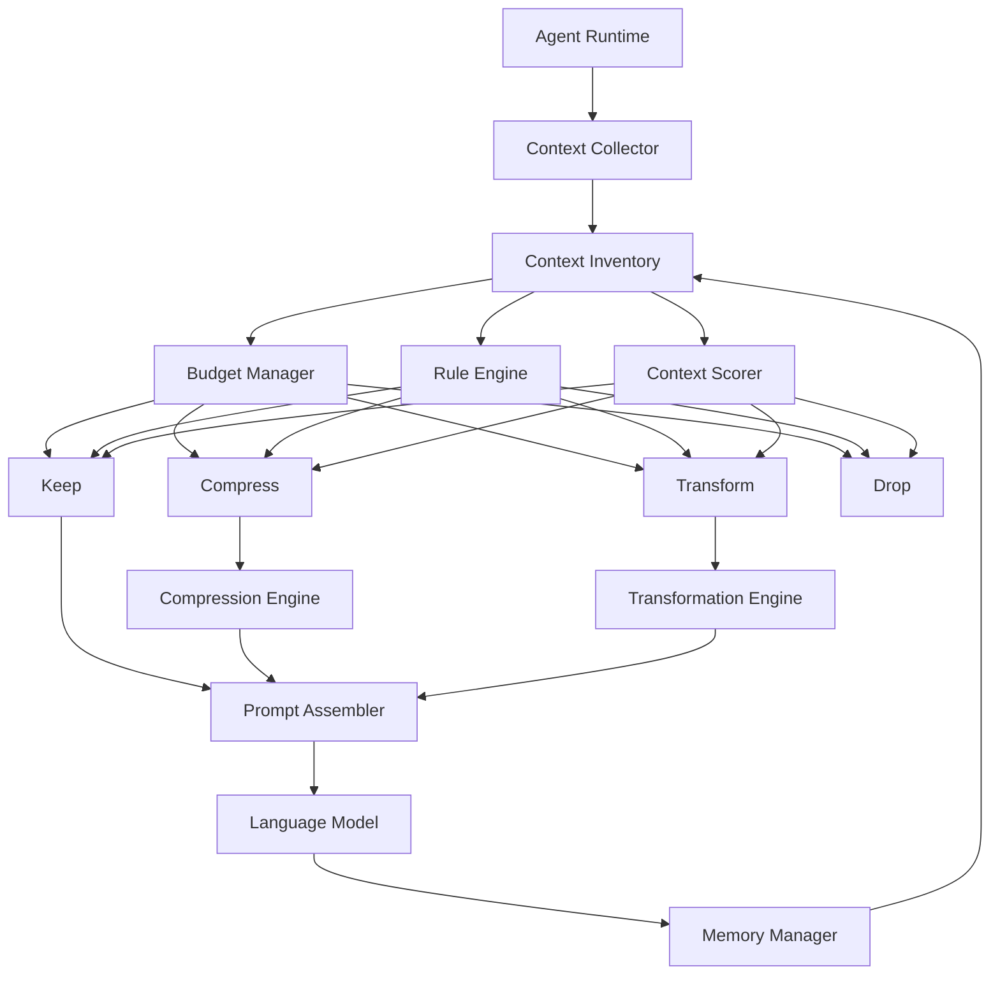
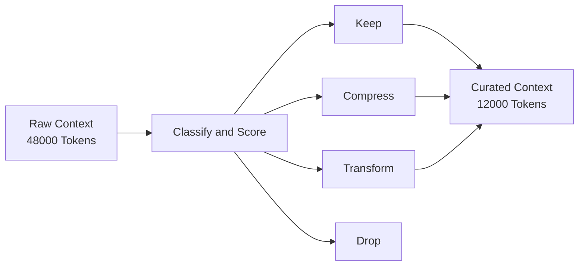
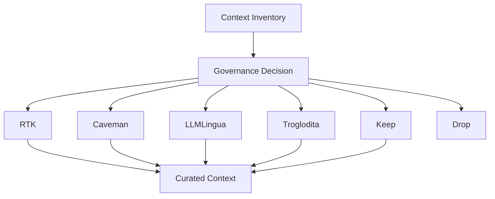

# ECC Curator

> **Context governance for AI agents.**
>
> Preserve signal. Compress redundancy. Eliminate noise.

ECC Curator is a context governance engine for AI agents.

Most token optimisation tools focus on making information smaller. ECC Curator focuses on deciding whether that information deserves attention in the first place.

Before information reaches a language model, ECC Curator classifies, scores, budgets, compresses, transforms, or removes it to maximise reasoning value within a finite context window.

---

## The Problem

Modern AI agents do not suffer from a lack of information.

They suffer from an overabundance of information.

As agents work, they accumulate:

- conversation history
- plans
- memories
- terminal output
- test results
- code diffs
- retrieved documents
- tool responses

Over time, context grows faster than understanding.

This eventually leads to:

- context-window exhaustion
- token budget overruns
- degraded reasoning quality
- increased latency
- unnecessary model escalation
- repeated failures
- rising infrastructure costs

The challenge is no longer generating information.

The challenge is deciding what deserves attention.

---

## The ECC Curation Principle

ECC Curator is based on a simple observation:

> As context grows, information density decreases. Beyond a certain threshold, additional context contributes more noise than reasoning value.

Every context window is a scarce resource.

Every token spent on low-value information is a token unavailable for reasoning.

The role of a curator is to maximise information density by continuously deciding:

```text
KEEP
COMPRESS
TRANSFORM
DROP
```

---

## Compression Is Not Enough

Several excellent projects already address token optimisation from different angles:

| Project | Focus |
|----------|----------|
| RTK | Tool output compression |
| Caveman | Natural language compression |
| LLMLingua | Prompt compression |
| Troglodita | Token reduction |

ECC Curator is not a replacement for these systems.

ECC Curator operates one level above them.

Rather than asking:

> "How can this be smaller?"

ECC Curator asks:

> "Should this information remain in the context at all?"

Governance happens before optimisation.

Compression is merely one of the available strategies.

---

## Vision

```text
Input
  ↓
Classify
  ↓
Score
  ↓
Budget
  ↓
Choose Strategy
  ↓
Keep
Compress
Transform
Drop
```

ECC Curator acts as the portfolio manager for context.

Every piece of information consumes budget.

Every piece of information must justify its existence.

---

## Why ECC Curator Exists



---

## Architecture



---

## The Curation Pipeline



---

## Core Concepts

### Context Inventory

A structured inventory of everything the agent could send to a model:

- goals
- tasks
- memories
- tool outputs
- logs
- diffs
- files
- plans
- retrieved content

### Context Scoring

Every item receives a reasoning-value score.

Example:

```text
Task Goal            1.00
Current File         0.95
Recent Diff          0.90

Historical Plan      0.45

Terminal Noise       0.10
```

### Token Budgeting

Context is treated as a finite portfolio.

Example:

```text
Available Budget

Goals               5%
Tasks              10%
Source Files       30%
Diffs              20%
Memories           15%
Logs                5%
Reserve            15%
```

Budget decisions become explicit rather than accidental.

### Strategy Selection

For each context item:

```text
KEEP
COMPRESS
TRANSFORM
DROP
```

Possible transformations include:

```text
Raw Log
    ↓
Failure Summary

Test Output
    ↓
Structured Findings

Long Plan
    ↓
Decision Record
```

---

## Ecosystem Positioning

ECC Curator is designed to orchestrate existing optimisation technologies rather than replace them.



ECC Curator owns the decision.

Compression engines execute the optimisation strategy.

---

## Roadmap

### Phase 1 — Deterministic Governance

- Context inventory
- Token budgeting
- Context classification
- Rule engine
- Keep/Compress/Drop decisions

### Phase 2 — Adaptive Scoring

- Heuristic relevance scoring
- Retention policies
- Context ageing
- Portfolio allocation

### Phase 3 — Pluggable Optimisation

- RTK integration
- Caveman integration
- LLMLingua integration
- Troglodita integration

### Phase 4 — Decision Intelligence

- Jev integration
- Context retention decisions
- Memory importance scoring
- Compression strategy selection

### Phase 5 — Agent Ecosystem

- Claude Code
- OpenCode
- Codex
- Cline
- Aider
- ECC Harness

---

## Mission

ECC Curator does not attempt to increase context windows.

ECC Curator attempts to increase the value of every token inside them.

> The future of autonomous agents is not more context.
>
> The future of autonomous agents is better context.

---

## Status

🚧 Design Phase

Currently defining:

- governance architecture
- context schemas
- scoring models
- budgeting strategies
- compression adapters
- evaluation framework

Contributions, experiments, and design discussions are welcome.
