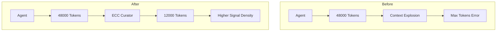
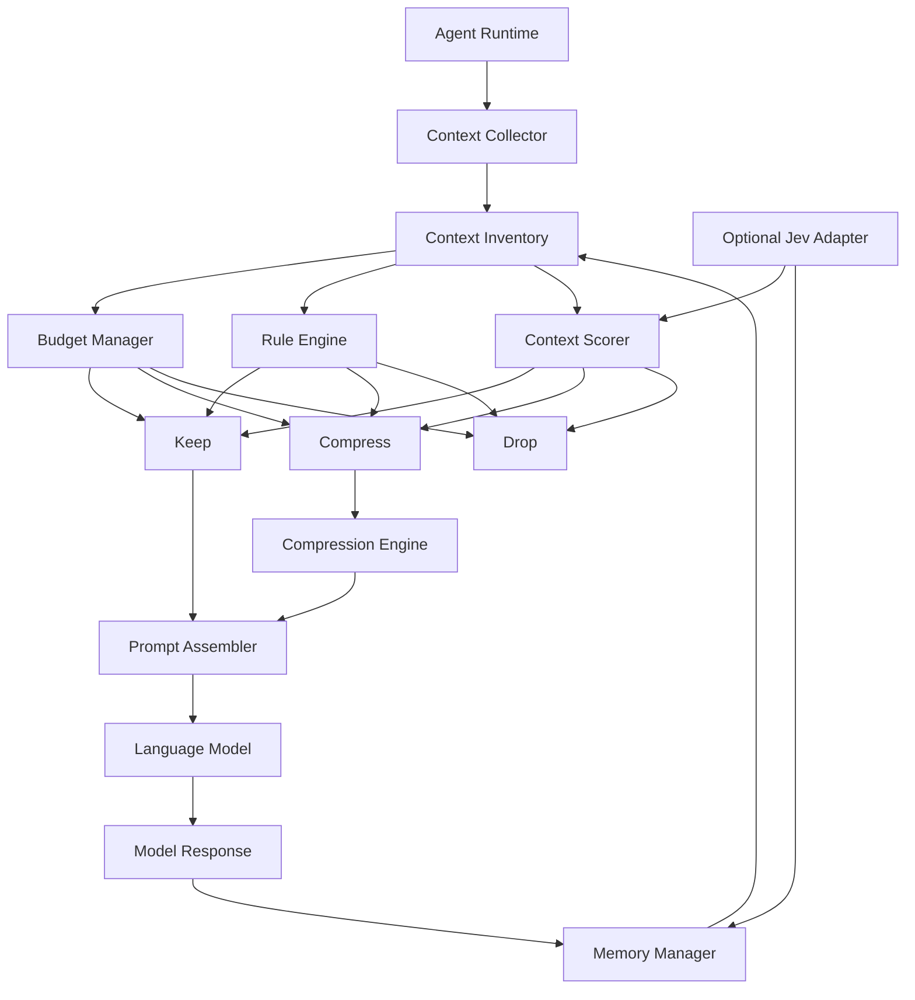
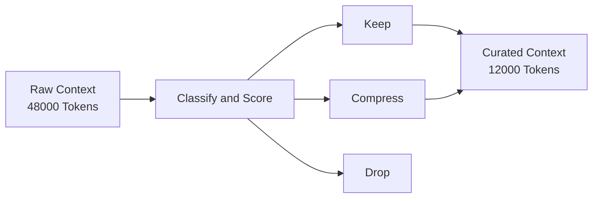

# ECC Curator Architecture

> Curating context for intelligent agents operating under finite attention and context constraints.

## Overview

ECC Curator is a context governance engine that sits between an AI agent and a language model.

Its purpose is not to generate responses, store memories, or orchestrate workflows.

Its sole responsibility is to determine what information should enter the model's context window.

```text
Agent
  │
  ▼
ECC Curator
  │
  ▼
LLM
```

## Design Philosophy

Most agent frameworks assume that more context improves reasoning.

ECC Curator is built on the opposite assumption:

> Beyond a certain threshold, additional context contributes more noise than reasoning value.

As context grows:

- signal density decreases
- token consumption increases
- latency increases
- reasoning quality degrades
- context limits are reached

ECC Curator exists to maximise information density within a finite context budget.

For every piece of context:

```text
KEEP
COMPRESS
DROP
```

must be treated as an explicit architectural decision.

---

# Why ECC Curator Exists



---

# High-Level Architecture



---

# Context Lifecycle

Every context item moves through the same pipeline.



---

# Core Components

## Context Collector

Responsible for gathering available information from the agent runtime.

Examples:

- conversation history
- task plans
- memories
- tool outputs
- terminal logs
- test results
- source files
- git diffs

Output:

```typescript
ContextItem[]
```

---

## Context Inventory

Central working set representing all currently available context.

The inventory tracks:

- token estimates
- age
- source
- priority
- references
- compression status

The inventory does not decide what to keep.

It only maintains metadata.

---

## Budget Manager

Responsible for enforcing hard context limits.

Example:

```yaml
model_context: 64000

reserved_for_output: 8000

max_prompt_budget: 56000
```

The Budget Manager guarantees that the assembled prompt never exceeds the allowed budget.

---

## Rule Engine

Applies deterministic decisions.

Examples:

```yaml
terminal_output:
  ttl_turns: 3

test_output:
  compress_after: 1

completed_tasks:
  drop_after: 5
```

Advantages:

- fast
- explainable
- deterministic
- no model dependency

---

## Context Scorer

Evaluates reasoning value.

Typical signals:

- recency
- relevance
- references
- task association
- source type
- user importance

Output:

```typescript
importance: 0.0 -> 1.0
```

Examples:

```text
Current Goal       1.00
Current Task       0.95
Active File        0.90

Recent Diff        0.80

Historical Plan    0.40

Terminal Noise     0.10
```

---

## Compression Engine

Reduces token footprint while retaining information value.

Examples:

```text
Raw
  ↓
Summarised

or

Verbose
  ↓
Structured

or

Large
  ↓
Extracted Findings
```

Compression is used only when information still has value.

---

## Memory Manager

Maintains long-lived information across agent iterations.

Responsibilities:

- retention policies
- memory ageing
- memory promotion
- memory eviction

The memory manager determines what remains available for future curation cycles.

---

## Prompt Assembler

Produces the final prompt delivered to the model.

Responsibilities:

- merge retained context
- include compressed context
- enforce token limits
- preserve ordering guarantees

Output:

```typescript
Prompt
```

---

# Decision Flow

```text
Agent Creates Context
          │
          ▼
Context Inventory
          │
          ▼
Classify
          │
          ▼
Score
          │
          ▼
KEEP?
COMPRESS?
DROP?
          │
          ▼
Prompt Assembly
          │
          ▼
LLM Invocation
```

---

# Jev Integration

Jev is optional.

ECC Curator is intentionally designed to function without Jev.

Phase 1 uses:

```text
Deterministic Rules
+
Heuristic Scoring
```

Phase 2 introduces:

```text
Jev Decision Intelligence
```

Potential Jev decisions:

```text
ContextRetentionDecision
MemoryImportanceDecision
CompressionDecision
RetryDecision
ModelEscalationDecision
```

ECC Curator owns governance.

Jev provides decision intelligence.

---

# Future Architecture

```text
ECC Ecosystem

ecc-curator
    ↓
Context Governance

ecc-memory
    ↓
Persistent Knowledge

ecc-router
    ↓
Model Governance

ecc-harness
    ↓
Agent Orchestration
```

ECC Curator is intended to become the context layer for the broader ECC ecosystem.

---

# Guiding Principle

> The future of autonomous agents is not more context.
>
> It is better context.
