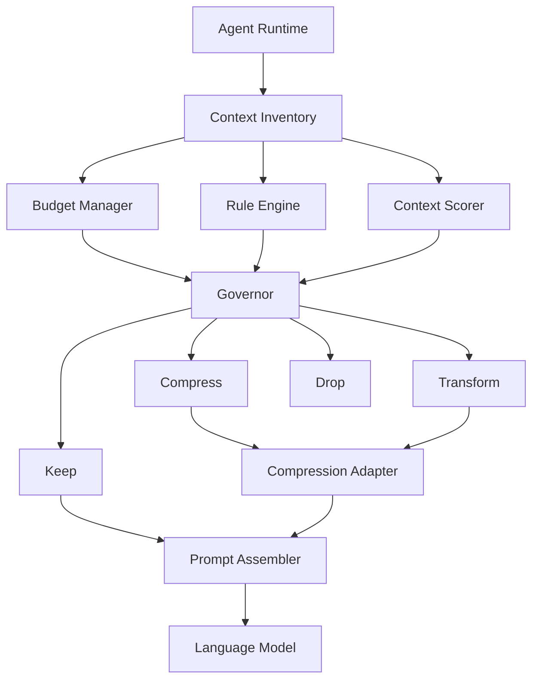
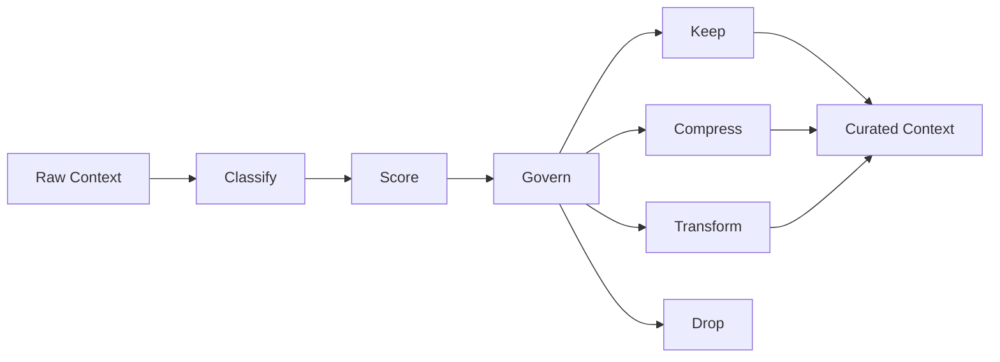
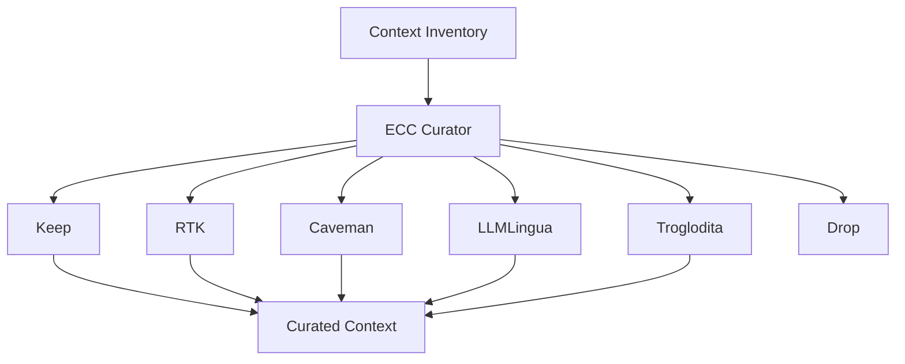

# Architecture

> ECC Curator is a context governance engine that helps AI agents maximise reasoning value within finite context windows.

Unlike traditional token-optimisation tools that focus exclusively on compression, ECC Curator focuses on **attention allocation**.

Its primary responsibility is deciding what deserves space inside a model's context window.

---

# Design Principles

## Governance Before Compression

Compression is a strategy.

Governance is the decision.

Before optimising information, ECC Curator first determines whether the information should remain in the context at all.

```text
Information
    ↓
Governance
    ↓
Keep
Compress
Transform
Drop
```

---

## Finite Context Is A Resource

Every model operates within a finite context window.

Each token has an opportunity cost.

Adding information to a prompt should be treated as an investment decision.

```text
More Context
≠
Better Context
```

ECC Curator aims to maximise:

```text
Reasoning Value
────────────────
Token Cost
```

---

## Context As A Portfolio

ECC Curator treats context as a managed portfolio rather than an unbounded conversation history.

Every item consumes budget.

Every item must justify its existence.

Example:

```text
Current Goal       High Value
Current Task       High Value
Active File        High Value

Historical Plan    Medium Value

Terminal Noise     Low Value
```

Limited budget should flow toward the highest-value context.

---

# System Overview



---

# Context Lifecycle

Every piece of context follows the same lifecycle.



---

# Core Components

## Context Inventory

The Context Inventory contains everything the agent could potentially send to a model.

Examples:

- goals
- tasks
- memories
- plans
- tool outputs
- logs
- source files
- diffs
- retrieved content

The inventory is the source of truth for context governance.

---

## Budget Manager

Responsible for enforcing context limits.

Example:

```yaml
context_window: 64000

output_reserve: 8000

working_budget: 56000
```

The Budget Manager guarantees the final prompt remains within budget.

---

## Rule Engine

Provides deterministic governance.

Example rules:

```yaml
terminal_output:
  ttl_turns: 3

completed_tasks:
  drop_after: 5

test_output:
  compress_after: 1
```

Advantages:

- predictable
- explainable
- fast
- model-independent

---

## Context Scorer

Assigns a reasoning-value score to each item.

Example:

```text
Current Goal      1.00
Current Task      0.95
Current File      0.92

Recent Plan       0.50

Terminal Noise    0.10
```

Scores influence budget allocation and strategy selection.

---

## Governor

The Governor is the central decision-making component.

For every context item it chooses:

```text
KEEP
COMPRESS
TRANSFORM
DROP
```

This component embodies the ECC Curation Principle.

---

## Compression Adapter

Compression is intentionally pluggable.

ECC Curator does not aim to replace specialised optimisation engines.

Instead it orchestrates them.

Potential integrations include:

| Project | Purpose |
|----------|----------|
| RTK | Tool output compression |
| Caveman | Natural language compression |
| LLMLingua | Prompt compression |
| Troglodita | Token reduction |

ECC Curator owns the decision.

Optimisation engines execute the strategy.

---

# Ecosystem Positioning



---

# Future Decision Intelligence

The initial architecture relies on:

```text
Rules
+
Budgets
+
Heuristic Scoring
```

Future versions may introduce decision intelligence providers such as Jev.

Potential decisions:

```text
ContextRetentionDecision
CompressionDecision
MemoryImportanceDecision
RetryDecision
ModelEscalationDecision
```

ECC Curator remains responsible for governance.

Decision engines provide additional reasoning capabilities.

---

# Guiding Principle

> Compression makes context smaller.
>
> Governance makes context better.

ECC Curator exists to ensure that the most valuable information reaches the model while everything else is compressed, transformed, or removed.
