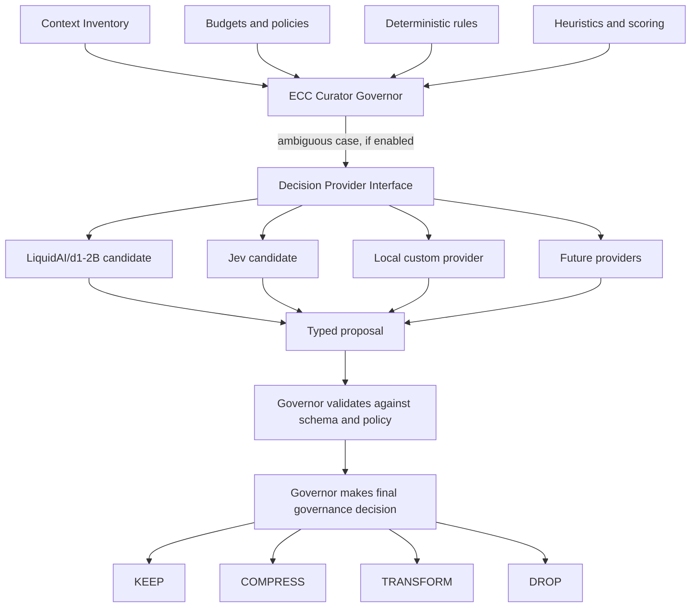

# Decision Intelligence

> ECC Curator governs context. Decision providers are optional components that help evaluate ambiguous governance decisions.

This document describes the provider-neutral design for decision intelligence. It is an architectural proposal, not an implemented runtime or provider integration. For provider-independent request and proposal shapes, see [Decision Schemas](DECISION_SCHEMAS.md). Candidate provider status is summarized in [Providers](PROVIDERS.md).

## Purpose

Long-running coding sessions accumulate context with different relevance, cost, and lifetime. ECC Curator's Governor decides how each item participates in the working context:

```text
KEEP
COMPRESS
TRANSFORM
DROP
```

Rules and heuristics cover predictable and routine cases. Optional decision providers may help assess cases where task relevance, item value, or strategy is ambiguous. A provider returns a proposal; ECC Curator retains policy, validation, and execution.

## Design philosophy

- **Governance stays in ECC Curator.** The Governor applies policy and makes the final decision.
- **Providers are optional and replaceable.** No provider is a core dependency or owns governance.
- **Deterministic first.** Rules and heuristics remain useful without model inference, network access, or provider availability.
- **Local first.** Local providers are preferred evaluation candidates for local coding-agent workflows, but local execution and resource fit must be verified.
- **Typed and bounded.** A provider receives only the decision-specific state it needs and returns a constrained proposal.
- **Evaluate outcomes.** Measure task completion, tests, context use, retries, escalation, latency, and resource use; do not treat token reduction alone as success.

## Deterministic-first approach

The order of consideration is:

```text
Rules
  ↓
Heuristics
  ↓
Decision Provider Interface (optional)
  ├── LiquidAI/d1-2B (reference local evaluation candidate)
  ├── Jev (reference provider candidate)
  ├── Local custom providers
  └── Future providers
  ↓
Governor validates, applies policy, and decides
```

The provider interface is an optional path for uncertain cases, not a required stage on every item. The Governor may resolve a case through policy or heuristics without calling a provider.

## Provider architecture



Providers do not receive authority to override policy or budgets. Compression and transformation execution is handled separately by the corresponding strategy providers after governance has selected an allowed action.

## Decision lifecycle

1. **Collect:** Build a bounded context item and decision-specific state.
2. **Apply hard rules:** Enforce pins, explicit policies, privacy constraints, budget limits, retry ceilings, and configured allowlists.
3. **Score:** Apply deterministic heuristics where available.
4. **Escalate optionally:** If the result is ambiguous and policy allows it, request a provider proposal for an allowed decision kind.
5. **Validate:** Validate the response shape, decision kind, allowed outcome, score ranges, and policy constraints.
6. **Decide:** The Governor selects the final action. Provider output is advisory evidence only.
7. **Execute separately:** If the final action is `COMPRESS` or `TRANSFORM`, invoke the selected execution provider and validate its result.
8. **Record:** Keep decision provenance and fallback reason sufficient for review and evaluation, subject to privacy policy.

## Rules vs heuristics vs providers

| Mechanism | Best suited for | Limitations |
|---|---|---|
| Rules | Explicit policy, pins, expiry, hard ceilings, allowlists, deterministic mappings | Cannot infer nuanced semantic relevance by themselves |
| Heuristics | Ranking by recency, references, task relation, token cost, or known metadata | Approximate; thresholds and weights need evaluation |
| Decision providers | Ambiguous semantic classification, scoring, or routing over bounded, structured state | Optional inference cost and failure modes; outputs require validation and must not bypass policy |

These are complementary layers. Provider output does not replace a rule or cause a heuristic to become authoritative.

## Decision-specific guardrails

| Decision kind | Provider role | Governor-owned guardrail |
|---|---|---|
| `ContextRetentionDecision` | Propose retain, compress, transform, or drop; optionally score relevance | Enforce pins, user policy, and token budget; validate the action |
| `MemoryImportanceDecision` | Propose an importance score or retention tier | Enforce explicit retention constraints and validate allowed tiers/ranges |
| `CompressionStrategyDecision` | Rank or select a registered compression strategy | Select only available, allowlisted strategies; provider does not perform compression |
| `TransformationDecision` | Select or recommend a registered transformation | Select only available transformations; provider does not generate or execute the transformed content |
| `RetryDecision` | Advise whether a retry appears warranted | Enforce attempt ceilings, idempotency, transient-error rules, and stop conditions |
| `ModelEscalationDecision` | Advise whether a candidate model change may help | Enforce privacy, user approval, hardware, and cost policies; no automatic escalation by provider authority |

The corresponding provider-independent fields and outcomes are specified in [Decision Schemas](DECISION_SCHEMAS.md).

## Provider interface

The conceptual interface is provider-neutral:

```typescript
type DecisionKind =
  | "ContextRetentionDecision"
  | "MemoryImportanceDecision"
  | "CompressionStrategyDecision"
  | "TransformationDecision"
  | "RetryDecision"
  | "ModelEscalationDecision";

interface DecisionProvider {
  readonly id: string;
  readonly capabilities: readonly DecisionKind[];
  evaluate(request: DecisionRequest): Promise<DecisionProposal>;
}
```

`DecisionRequest` and `DecisionProposal` are defined in [Decision Schemas](DECISION_SCHEMAS.md). This is a proposed API, not an implemented interface. A provider must declare capabilities, accept only supported decision kinds, return schema-valid outcomes, and avoid assuming it has the full conversation or unrestricted access to the context store.

## Fallback behavior

The Governor should:

- Skip provider invocation when deterministic policy fully resolves the case.
- Fall back to the applicable rule/heuristic/default policy when the provider is unavailable, times out, errors, or returns invalid data.
- Reject unknown decision kinds, disallowed outcomes, out-of-range scores, or provider-invented strategy identifiers.
- Preserve hard safeguards regardless of provider confidence.
- Record provider identity, schema version, and fallback reason when permitted by privacy policy.
- Surface configuration errors explicitly; it must not silently present fallback as a provider success.

A fallback is a governance policy decision, not an implicit provider retry. Retry limits and timeouts are configured by the host implementation.

## Local-first considerations

LiquidAI/d1-2B is the current reference **local evaluation candidate**, not an integrated or required provider. Its decision-oriented typed outputs appear relevant to classification and routing, but local resource fit and task performance have not been established by ECC Curator. Its model card reports that answers become less reliable beyond about 64K tokens of state, so providers should receive bounded, task-scoped decision inputs rather than an assumed full session transcript.

Jev is a reference provider candidate under the same interface. Its deployment mode and local resource requirements must be verified before claims about offline operation or coexistence with a coding model.

For the target local coding workflow, a decision provider may help answer **what deserves attention?** while a coding model such as `ISTA-DASLab/Qwen3.8-Flash-Next-GSQ-RCO-Coder-GGUF` addresses **how to solve the coding task?** This separation is a design hypothesis. Evaluate peak RAM/VRAM, latency, context state size, and task outcomes with both workloads before recommending an execution setup.

Neither Liquid AI nor Jev is an endorsement, implementation claim, or core dependency. See [Providers](PROVIDERS.md) for status and evidence boundaries.
