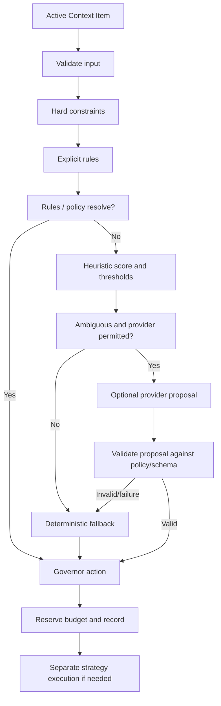

# Governor Algorithm

> The Governor owns governance. Optional providers return proposals; the Governor validates policy and makes the final decision.

This specification turns the proposed governance flow into deterministic implementation requirements. It is not evidence that a Governor exists in the repository. Related contracts are in [Context Model](CONTEXT_MODEL.md), [Scoring Spec](SCORING_SPEC.md), [Inventory API](INVENTORY_API.md), [Prompt Assembler](PROMPT_ASSEMBLER.md), [Decision Intelligence](DECISION_INTELLIGENCE.md), and [Decision Schemas](DECISION_SCHEMAS.md).

## Responsibilities

The Governor:

- Reads a consistent inventory snapshot, rules, policies, current budget state, heuristic scores, and optionally provider proposals.
- Applies hard constraints before preferences.
- Produces one final `KEEP`, `COMPRESS`, `TRANSFORM`, or `DROP` decision for each eligible active item.
- Applies deterministic tie-breaking and budget-pressure policy.
- Optionally asks an enabled provider for a proposal when rules and heuristics leave a material ambiguity.
- Validates all proposals and retains final decision authority.
- Emits decisions and reasons for audit and evaluation.

The Governor does not ingest or persist inventory state, estimate tokens itself, compress text, transform content, or construct the final prompt. Those responsibilities belong to the [Inventory API](INVENTORY_API.md), strategy providers, and [Prompt Assembler](PROMPT_ASSEMBLER.md).

## Inputs and outputs

```typescript
interface GovernorInput {
  inventory: ContextInventorySnapshot;
  policies: GovernancePolicySet;
  rules: readonly GovernanceRule[];
  budget: BudgetState;
  scores: ReadonlyMap<string, number>;
  decisionProvider?: DecisionProvider;
  enabledDecisionKinds: ReadonlySet<DecisionKind>;
}

interface GovernanceResult {
  decisions: readonly GovernanceDecisionRecord[];
  unresolvedItemIds: readonly string[];
  budget: BudgetState;
}

interface GovernanceDecisionRecord {
  itemId: string;
  action: "KEEP" | "COMPRESS" | "TRANSFORM" | "DROP";
  reasonCode: string;
  score: number;
  providerProposal?: DecisionProposal;
}

interface BudgetState {
  availableInputTokens: number;
  committedTokens: number;
  outputReserveTokens: number;
  safetyMarginTokens: number;
}

interface GovernanceRule {
  ruleId: string;
  priority: number;
  scope: "item" | "context_type" | "global";
  itemId?: string;
  contextType?: string;
  action: "KEEP" | "COMPRESS" | "TRANSFORM" | "DROP";
}

interface GovernancePolicySet {
  allowedActionsByType: Readonly<Record<string, readonly GovernanceRule["action"][]>>;
  providerEscalationEnabled: boolean;
  ambiguityRange?: readonly [number, number];
  fallbackByDecisionKind: Readonly<Record<string, string>>;
  thresholds: {
    keepAtOrAbove: number;
    retainAtOrAbove: number;
  };
}
```

These are proposed contracts; concrete types should reuse the shared definitions in the Inventory API, Scoring Spec, and Decision Schemas rather than introduce duplicate production types.

Inputs:

- **Rules:** deterministic predicates and actions, including pins, explicit user choices, TTLs, and type-specific policy.
- **Policies:** allowed actions, hard constraints, provider permissions, thresholds, and strategy allowlists.
- **Budget state:** available input-token budget, reserve, already committed prompt tokens, and per-category allocations if configured.
- **Heuristic scores:** finite normalized scores in `[0, 1]`, calculated according to [Scoring Spec](SCORING_SPEC.md).
- **Provider proposals:** optional typed output for a supported decision kind. The provider cannot alter the policy, budget, or action allowlists.

## Deterministic evaluation order

For each active item, evaluate in this order:

1. **Validate input.** Reject duplicate IDs, invalid state transitions, non-finite/out-of-range scores, or invalid token estimates as explicit errors. Do not silently skip malformed items.
2. **Apply immutable hard constraints.** Enforce user pins, privacy rules, explicit user directives, maximum retry/escalation limits, and allowed strategy sets. A provider cannot override these constraints.
3. **Resolve matching explicit rules.** Resolve conflicts with the configured stable precedence: item-specific rule, context-type rule, global rule; within the same level, lower numeric `priority` wins, then stable `ruleId` ascending. A rule's action must be allowed by policy.
4. **Use a deterministic baseline.** If no explicit rule decides the action, use the context-type policy and heuristic score. The score ranks or classifies only according to configured thresholds; it does not override a hard rule.
5. **Consider provider escalation.** Only if the decision remains ambiguous, the decision kind is enabled, the provider declares that capability, and policy permits the call. Escalation is optional.
6. **Validate provider proposal.** Match request ID, kind, schema version, required fields, score bounds, allowed outcomes, registered strategy IDs, and current policy. Invalid output is a provider failure.
7. **Choose final action.** The Governor applies the deterministic selection policy to its inputs and any valid proposal. A proposal is advisory, never the final action by itself.
8. **Reserve budget and record.** Apply the action to the working-set plan, update provisional budget use, and emit a reason code and provenance.
9. **Execute separately.** Compression or transformation is performed only after the Governor selected that action; validate the result and re-evaluate its token estimate.



## Governance outcomes

| Action | Governor meaning | Execution responsibility |
|---|---|---|
| `KEEP` | Retain the current representation in the candidate working set. | Assembler includes it if it fits and policy allows. |
| `COMPRESS` | Select a registered compression strategy for an item still considered useful. | A compression provider produces a replacement; validate success and token count. |
| `TRANSFORM` | Select a registered transformation into a more useful representation. | A transformation provider produces a replacement; validate schema, provenance, and token count. |
| `DROP` | Exclude the item from the active working set. | No strategy execution. Inventory retention/removal is governed separately. |

`COMPRESS` and `TRANSFORM` do not mean the operation succeeded. If execution fails or output is invalid, follow the configured deterministic fallback; do not report a success-shaped result.

### Provisional threshold behavior

The initial deterministic profile may use `keepAtOrAbove = 0.65` and `retainAtOrAbove = 0.35`; these are reproducibility defaults to validate, not empirically tuned values. Require `0 <= retainAtOrAbove <= keepAtOrAbove <= 1`.

- At or above `keepAtOrAbove`: choose `KEEP` unless an explicit policy/rule selects another allowed action.
- Between the thresholds: choose `COMPRESS` only when compression is allowed and a registered strategy is available; otherwise choose `KEEP`.
- Below `retainAtOrAbove`: choose `DROP` unless a hard constraint or explicit rule forbids it.
- `TRANSFORM` is selected by an explicit deterministic rule or a valid provider proposal when transformation is enabled and a registered transformation exists. Otherwise do not invent a transformation.

MVP Phase 1 may support only `KEEP` and `DROP`; in that phase, treat the middle range as `KEEP`. Activate compression and provider-informed transformation only in the roadmap phases where their contracts/executors exist.

## Budget-pressure behavior

The Governor works with an explicit available budget, but final serialized prompt sizing belongs to the assembler.

1. Reserve tokens for fixed prompt content and model output before allocating context items.
2. Always account for hard-pinned items first. If pinned items alone exceed the available budget, return an explicit `BudgetConflict`; do not silently drop pins or claim a valid prompt.
3. Apply configured per-type/category caps.
4. Rank remaining items by score descending, then policy priority, recency, reference count, and stable item ID (see [Prompt Assembler](PROMPT_ASSEMBLER.md)).
5. For an item that does not fit, attempt only a policy-allowed `COMPRESS` or `TRANSFORM` strategy registered for that item. Re-estimate its output cost.
6. If it still cannot fit, use the configured deterministic overflow action (`DROP` or `ARCHIVE` if supported by policy). Do not invoke arbitrary providers to evade the budget.
7. If required content remains over budget, return a structured overflow result and let the host decide whether to reduce other fixed content or abort.

Budget estimates may be conservative before serialization. The assembler performs the final check on the complete prompt package.

## Provider escalation criteria

Escalate only when all conditions hold:

- Deterministic rules and hard policy do not already resolve the case.
- Heuristic output falls into a configured ambiguity range or the decision type explicitly requires semantic evaluation.
- The decision kind is in the provider's declared capabilities.
- Provider use is enabled for that decision and permitted by local/privacy/cost policy.
- Request inputs can be bounded and validated against the decision schema.
- A deterministic fallback exists.

Do not call providers for every item by default. Do not send an entire conversation when a summary and metadata suffice. For d1-2B in particular, use bounded decision state; its model card cautions that reliability falls beyond roughly 64K tokens of state.

**Implementation note (Phase 3).** `src/governor/provider.ts` implements these criteria as deterministic gates, each with an explicit skip code recorded in provenance: `ESCALATION_DISABLED`, `HARD_CONSTRAINT_PINNED`, `RULE_ALREADY_DECIDED`, `AMBIGUITY_NOT_CONFIGURED`, `AMBIGUITY_WINDOW_MISS`, `POLICY_TYPE_UNREGISTERED`, and `NO_ALLOWED_OUTCOMES` (policy-allowed ∩ governance-enabled ∩ executable-without-a-strategy-executor must be non-empty; Phase 3 MVP offers only `KEEP`/`DROP`).

## Provider fallback behavior

On provider disabled, unavailable, timeout, exception, unsupported kind, invalid response, or disallowed outcome:

1. Record provider failure/fallback reason where policy permits.
2. Apply the decision-specific deterministic fallback from policy, rules, or heuristic thresholds.
3. If no valid fallback exists, leave the item unresolved and return an explicit error; do not fabricate a successful action.
4. Never retry a provider call unless a separate bounded retry policy explicitly allows it.

Provider output cannot bypass policies, budgets, validation, registered provider lists, or deterministic safeguards (see ADR-011 in [Decisions](DECISIONS.md)).

**Implementation note (Phase 3).** The implemented fallback path returns the deterministic `GovernanceDecisionRecord` byte-for-byte; only the provenance record changes (status `provider_failed` plus the failure or violation code). Failure codes are typed, never success-shaped: `PROVIDER_DISABLED`, `NO_CAPABLE_PROVIDER`, `UNSUPPORTED_DECISION_KIND`, `PROVIDER_UNAVAILABLE`, `PROVIDER_TIMEOUT`, `PROVIDER_EXCEPTION`, and `PROPOSAL_INVALID` with a detail code (`DecisionProposalViolationCode`). Call ceilings are host-declared (`requestTimeoutMs` overrides the registry entry's `timeoutMs`, defaulting to 5s); invalid ceilings surface as explicit `InvalidContextItemError` configuration problems, and no provider call is retried. On the adoption path the final record's `reasonCode` is the explicit `PROVIDER_PROPOSAL_ADOPTED` — the deterministic band's reason would contradict a provider-chosen action — with the deterministic action/reason pair retained unchanged in provenance.

## Pseudocode

```text
function govern(snapshot, policy, rules, budget, scores, provider):
    validateSnapshot(snapshot)
    plan = emptyDecisionPlan()

    items = stableSort(activeItems(snapshot), by = itemIdAscending)

    for item in items:
        validateItem(item)

        hard = resolveHardConstraint(item, policy)
        if hard exists:
            plan.add(decision(item, hard.action, hard.reason))
            continue

        rule = resolveRule(item, rules, policy)
        if rule exists:
            plan.add(decision(item, rule.action, rule.reason))
            continue

        score = requireFiniteScore(scores[item.id], range = [0, 1])
        proposal = none

        action = classifyDeterministically(item, score, policy)
        if action is AMBIGUOUS and providerPermitted(item, policy, provider):
            request = buildBoundedRequest(item, score, budget, policy)
            response = tryProvider(request)
            if response is valid for request and policy:
                proposal = response
                action = governorSelect(item, score, response, policy)
            else:
                action = deterministicFallback(item, score, policy)

        plan.add(decision(item, action, score, proposal))

    plan = fitWorkingSet(plan, budget, policy)
    return plan.withExplicitConflictsOrOverflow()
```

`classifyDeterministically`, thresholds, and fallback actions must be configured and covered by tests. No provider is called for cases already resolved by a hard constraint or explicit rule.

## Worked examples

### Expired terminal output

```text
Input: terminal output; age exceeds configured TTL
Rule: terminal_output.ttl_turns = 3
Provider: not called
Result: DROP (reason: RULE_TTL_EXPIRED)
```

### Ambiguous historical plan

```text
Input: historical plan; still referenced; moderate score
Rule: no matching rule
Heuristic: within configured ambiguity range
Provider: optional ContextRetentionDecision proposal = TRANSFORM
Validation: TRANSFORM allowed; transformation is registered
Result: Governor selects TRANSFORM; separate executor runs afterward
Fallback: if provider fails, configured deterministic action applies
```

### Pinned item under budget pressure

```text
Input: pinned goal; available context budget is insufficient
Hard constraint: retain pinned item
Provider: not called
Result: retain pin in plan and return BudgetConflict if fixed + pinned content exceeds budget
```

## MVP vs future scope

### MVP requirements

- Implement inventory snapshot validation and deterministic rule precedence.
- Implement hard constraints, scores, stable ordering, and explicit reason codes.
- Preserve the roadmap's staged outcomes: Phase 1 begins with `KEEP`/`DROP`; later phases add scoring and strategy outcomes.
- Make provider invocation optional and disabled by default until the interface, schemas, validation, and fallback are implemented.
- Surface invalid input, provider failure, and budget conflict explicitly.

### Future scope

- Decision-specific provider routing and evaluation.
- Compression/transformation execution with measured output and rollback/archive policy.
- Portfolio allocation and adaptive budgets.
- Provider confidence calibration, parallel proposal comparison, and learned thresholds.
- Durable decision history and retrieval.

See [Roadmap](ROADMAP.md) for phase sequencing. This document specifies intended behavior, not current functionality.
