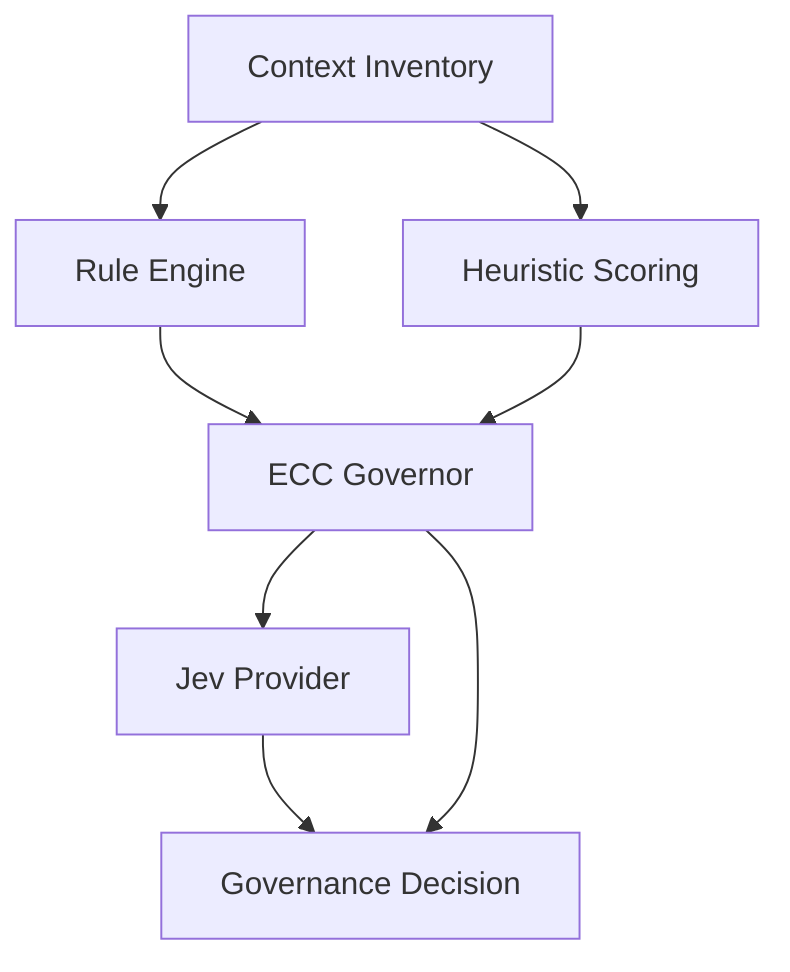

# Jev Integration

> ECC Curator is designed to work without Jev.
>
> Jev augments governance decisions. It does not replace governance.

This document describes how Jev may integrate with ECC Curator to provide structured decision intelligence for context governance.

---

# Why Jev?

ECC Curator's primary responsibility is determining:

```text
KEEP
COMPRESS
TRANSFORM
DROP
```

The initial implementation relies on:

- token budgeting
- deterministic rules
- heuristic scoring

These approaches solve many common context-management problems.

However, some context decisions are difficult to model using rules alone.

Examples:

```text
Is this log still relevant?

Is this memory worth keeping?

Should this plan be compressed?

Is this error likely to matter later?

Should this context be transformed instead of compressed?
```

Jev is a potential solution for these higher-order governance decisions.

---

# Design Principles

## Jev Is Optional

ECC Curator must never depend on Jev.

The following architecture must remain valid:

```text
ECC Curator
    ↓
Rules
    +
Scoring
    +
Budgeting
```

Jev simply becomes an additional decision provider.

---

## Deterministic First

Every governance decision should have a deterministic implementation.

Example:

```yaml
terminal_output:
  drop_after_turns: 3
```

Simple rules should not require AI evaluation.

Jev should only evaluate decisions that are ambiguous, expensive, or highly contextual.

---

## Governance Remains In ECC Curator

ECC Curator owns:

```text
Context Inventory
Budgets
Policies
Governance
Execution
```

Jev provides:

```text
Decision Intelligence
```

The final decision always belongs to ECC Curator.

---

# Architecture



---

# Decision Flow

Most context items should never reach Jev.

Example:

```text
Old Terminal Output
      ↓
Rule Match
      ↓
DROP
```

No AI decision required.

Jev is reserved for items where deterministic systems are uncertain.

Example:

```text
Historical Plan
      ↓
Score: 0.58
      ↓
Uncertain
      ↓
Jev Evaluation
      ↓
TRANSFORM
```

---

# Context Retention Decision

The most important candidate integration.

Question:

```text
Should this information remain available?
```

Example Input:

```json
{
  "decision": "context_retention",
  "item": {
    "type": "plan",
    "tokenCount": 2400,
    "ageTurns": 18,
    "references": 2
  }
}
```

Example Output:

```json
{
  "outcome": "COMPRESS",
  "confidence": 0.89
}
```

---

# Memory Importance Decision

Determines whether information deserves long-term retention.

Example Input:

```json
{
  "decision": "memory_importance",
  "memory": {
    "content": "Extension ID must remain stable",
    "references": 12,
    "ageTurns": 90
  }
}
```

Example Output:

```json
{
  "importance": 0.97,
  "tier": "PERMANENT"
}
```

Potential tiers:

```text
PERMANENT
LONG_TERM
WORKING
DISPOSABLE
```

---

# Compression Strategy Decision

Determines how information should be optimised.

Question:

```text
What is the most effective strategy?
```

Example:

```text
Large Build Log
```

Possible outcomes:

```text
RTK
Summary
Structured Findings
DROP
```

Example Output:

```json
{
  "strategy": "RTK",
  "confidence": 0.83
}
```

---

# Transformation Decision

Not all information should be compressed.

Some information becomes more valuable after transformation.

Example:

```text
5000-line build log
```

Potential outcomes:

```text
Raw Log
    ↓
Failure Summary

Raw Test Output
    ↓
Structured Findings

Large Plan
    ↓
Decision Record
```

Jev may determine when transformation is more useful than compression.

---

# Future Decisions

Potential future decision types:

```text
ContextRetentionDecision
MemoryImportanceDecision
CompressionStrategyDecision
TransformationDecision
RetryDecision
ModelEscalationDecision
AgentHandoffDecision
```

Not all of these belong in the initial implementation.

---

# Proposed Interface

```typescript
interface DecisionProvider {
  evaluate(
    decision: DecisionRequest
  ): Promise<DecisionResult>;
}
```

Example implementation:

```typescript
class JevProvider
  implements DecisionProvider
{
  async evaluate(
    request: DecisionRequest
  ): Promise<DecisionResult> {
    // Jev evaluation
  }
}
```

This allows future providers:

```text
Jev
Custom Scorers
Local Models
Rule-Based Evaluators
```

without architectural changes.

---

# Phased Adoption

## Phase 1

No Jev.

```text
Rules
+
Budgets
+
Heuristic Scoring
```

---

## Phase 2

Jev evaluates:

```text
ContextRetentionDecision
```

only.

The highest-value governance decision.

---

## Phase 3

Jev evaluates:

```text
MemoryImportanceDecision
CompressionStrategyDecision
TransformationDecision
```

---

## Phase 4

Jev participates in broader ECC ecosystem decisions:

```text
RetryDecision
ModelEscalationDecision
AgentHandoffDecision
```

---

# Success Criteria

Jev integration is considered successful if it:

- Improves signal density
- Reduces unnecessary context retention
- Increases reasoning efficiency
- Reduces context-window failures
- Performs better than heuristic scoring alone

while maintaining:

- deterministic fallbacks
- offline support
- local-first compatibility

---

# Guiding Principle

> Jev should not decide everything.
>
> Jev should decide the decisions that rules struggle to make.

ECC Curator governs context.

Jev provides decision intelligence when governance becomes uncertain.
