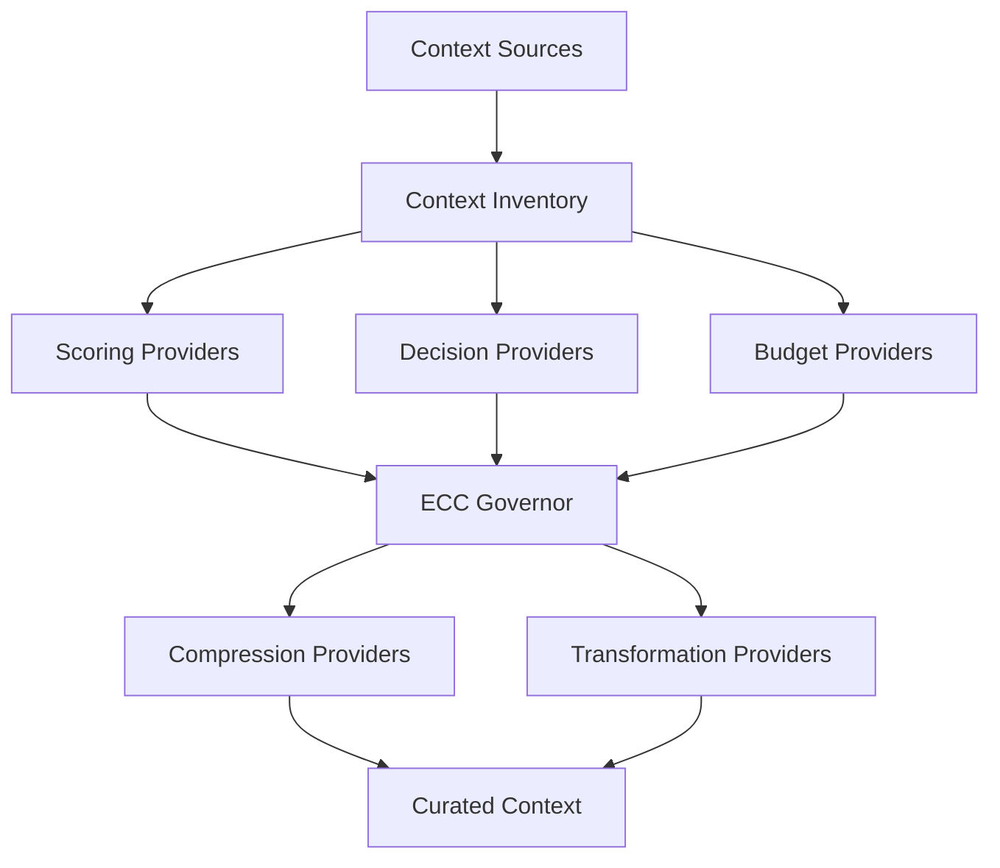

# Plugin API

> ECC Curator is designed to support extensions to its governance model.
>
> The proposed plugin design separates core governance from scoring engines, compression systems, transformation providers, and decision intelligence.

This document sketches a proposed plugin architecture. The interfaces and examples are not a statement that a plugin runtime or listed provider is currently implemented.

---

# Design Goals

The plugin system must be:

- Modular
- Deterministic
- Language-model agnostic
- Runtime configurable
- Designed for backward compatibility
- Easy to test

A plugin should be able to add capabilities without modifying the ECC Curator core.

---

# Plugin Categories

The proposed plugin categories are:

```text
Context Sources
Scoring Providers
Compression Providers
Transformation Providers
Decision Providers
Budget Providers
```

---

# Architecture



---

# Plugin Lifecycle

In this proposed design, plugins follow this lifecycle.

```text
Load
Initialize
Execute
Dispose
```

Example:

```typescript
await plugin.initialize();

const result = await plugin.execute(input);

await plugin.dispose();
```

---

# Base Plugin Interface

```typescript
export interface Plugin {
  name: string;

  version: string;

  initialize(): Promise<void>;

  dispose(): Promise<void>;
}
```

All plugin types extend this interface.

---

# Context Source Plugins

Context sources provide information to the inventory.

Examples:

- Agent messages
- Files
- Git diffs
- Logs
- MCP sources
- External memory systems

## Interface

```typescript
export interface ContextSource
  extends Plugin {

  collect(): Promise<ContextItem[]>;
}
```

---

# Scoring Provider Plugins

Scoring providers assign value scores.

Example:

```text
Goal          1.00

Current Task  0.95

Build Log     0.10
```

## Interface

```typescript
export interface ScoringProvider
  extends Plugin {

  score(
    item: ContextItem
  ): Promise<number>;
}
```

Returns:

```text
0.0 -> 1.0
```

---

# Budget Provider Plugins

Budget providers determine available prompt budget.

Example:

```yaml
context_window: 64000

reserve_output: 8000
```

## Interface

```typescript
export interface BudgetProvider
  extends Plugin {

  getBudget(
    inventory: ContextInventory
  ): Promise<TokenBudget>;
}
```

---

# Compression Provider Plugins

Compression providers reduce token footprint.

ECC Curator chooses when compression occurs.

Providers implement how.

Examples:

- RTK
- Caveman
- LLMLingua
- Troglodita

## Interface

```typescript
export interface CompressionProvider
  extends Plugin {

  compress(
    item: ContextItem
  ): Promise<ContextItem>;
}
```

## Illustrative example only; not a measured result

```text
Original
────────
5000 Tokens

Compressed
──────────
300 Tokens
```

---

# Transformation Provider Plugins

Transformation providers create higher-value representations.

Unlike compression, transformation may change structure.

## Example

```text
Raw Log
    ↓
Failure Summary
```

```text
Test Output
    ↓
Structured Findings
```

## Interface

```typescript
export interface TransformationProvider
  extends Plugin {

  transform(
    item: ContextItem
  ): Promise<ContextItem>;
}
```

---

# Decision Provider Plugins

Decision providers are first-class optional components in the proposed extension architecture. They help evaluate ambiguous governance decisions by returning typed proposals; they do not own governance policy or execute actions.

The decision order remains:

```text
Rules
  ↓
Heuristics
  ↓
Optional Decision Provider
  ↓
Governor validates and decides
```

## Interface

```typescript
export type DecisionKind =
  | "ContextRetentionDecision"
  | "MemoryImportanceDecision"
  | "CompressionStrategyDecision"
  | "TransformationDecision"
  | "RetryDecision"
  | "ModelEscalationDecision";

export interface DecisionRequest<TInput = unknown> {
  requestId: string;
  kind: DecisionKind;
  schemaVersion: "1";
  input: TInput;
  allowedOutcomes: readonly string[];
  policyVersion: string;
}

export interface DecisionProposal<TOutcome = unknown> {
  requestId: string;
  kind: DecisionKind;
  schemaVersion: "1";
  outcome: TOutcome;
  confidence?: number;
  scores?: Record<string, number>;
  rationaleCode?: string;
}

export interface DecisionProvider
  extends Plugin {

  id: string;

  capabilities: readonly DecisionKind[];

  evaluate(
    request: DecisionRequest
  ): Promise<DecisionProposal>;
}
```

Decision kinds, input fields, outcomes, and validation rules are described in [Decision Schemas](DECISION_SCHEMAS.md). The interface is proposed and is not implemented in this repository.

---

# Governance Decisions

The Governor owns the final governance outcome:

```text
KEEP
COMPRESS
TRANSFORM
DROP
```

The provider proposal must be validated against the request's decision kind and allowlisted outcomes. The Governor then applies policy, budgets, and safeguards before deciding.

## Provider capabilities

Providers declare the `DecisionKind` values they implement. The registry must reject unsupported decision kinds rather than silently route them to a provider. Candidate providers such as LiquidAI/d1-2B and Jev are optional and are not implemented here.

## Validation and allowed outcomes

The Governor validates schema version, request identity, decision kind, required fields, value ranges, and outcome membership in `allowedOutcomes`. Provider confidence or scores never override user policy, pins, budgets, provider allowlists, retry ceilings, or escalation constraints. Invalid or unsupported proposals are treated as provider failures.

## Deterministic fallback

When a provider is disabled, unavailable, times out, errors, or returns invalid data, the Governor follows the configured deterministic rule, heuristic, or explicit default. It records fallback provenance where permitted. Fallback must not be reported as a successful provider response, and providers cannot retry actions or execute compression/transformation themselves.

See [Decision Intelligence](DECISION_INTELLIGENCE.md) for the lifecycle and [Providers](PROVIDERS.md) for candidate status.

---

# Proposed Provider Registry

The proposed design registers plugins within a central registry.

```typescript
registry.register(
  plugin
);
```

Illustrative registry example only; provider implementations are not currently present:

```typescript
registry.register(
  new LLMLinguaProvider()
);

registry.register(decisionProvider);
```

---

# Configuration

The following is a conceptual per-decision configuration. It does not imply that these provider IDs are available in a runtime:

Example:

```yaml
plugins:

  scoring:
    - heuristic

  compression:
    - llmlingua
    - caveman

  transformations:
    - summariser

  decision_intelligence:
    context_retention:
      provider: d1-2b

    memory_importance:
      provider: jev

    compression_strategy:
      provider: heuristic
```

---

# Strategy Resolution

The intended strategy-resolution flow selects a provider based on the governance decision.

Example:

```text
Context Item
      ↓

Decision

      ↓

COMPRESS

      ↓

LLMLingua
```

or

```text
Context Item
      ↓

Decision

      ↓

TRANSFORM

      ↓

Failure Summary Plugin
```

Governance remains separate from execution.

---

# Example Plugin

A minimal scoring provider:

```typescript
export class StaticScorer
  implements ScoringProvider {

  name = "static";

  version = "1.0.0";

  async initialize() {}

  async dispose() {}

  async score(
    item: ContextItem
  ): Promise<number> {

    if (item.type === "goal") {
      return 1.0;
    }

    if (
      item.type === "terminal_output"
    ) {
      return 0.2;
    }

    return 0.5;
  }
}
```

---

# Future Extensions

Possible future plugin categories:

```text
Memory Providers
Retrieval Providers
Telemetry Providers
Evaluation Providers
Agent Providers
```

The architecture should support new plugin types without requiring changes to the governance engine.

---

# Guiding Principle

> ECC Curator decides **what should happen**.
>
> Plugins decide **how it happens**.

This separation allows governance policies to remain stable while optimisation technologies continue evolving.
