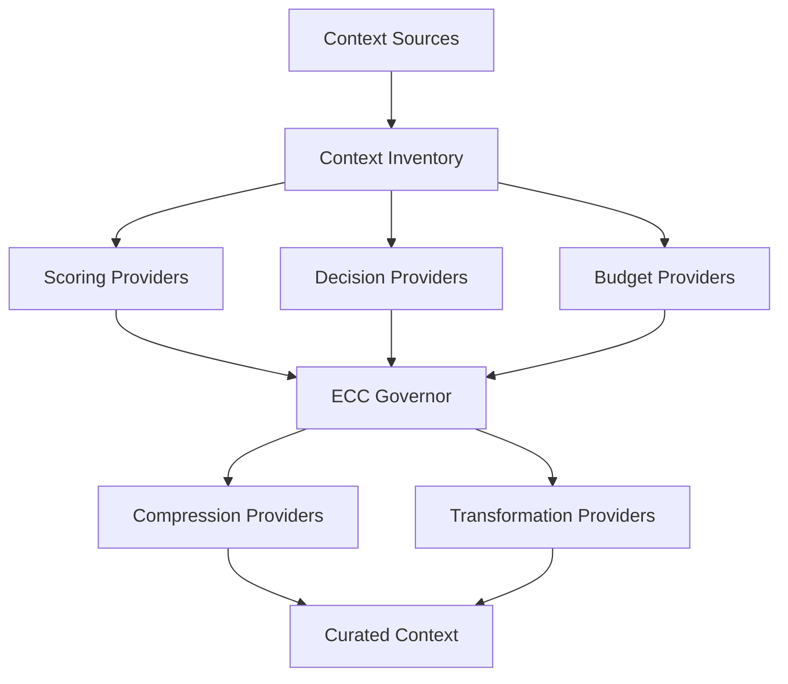

# Plugin API

> ECC Curator is designed as an extensible governance platform.
>
> Core governance remains stable while scoring engines, compression systems, transformation providers, and decision intelligence can be added through plugins.

This document defines the initial plugin architecture.

---

# Design Goals

The plugin system must be:

- Modular
- Deterministic
- Language-model agnostic
- Runtime configurable
- Backward compatible
- Easy to test

A plugin should be able to add capabilities without modifying the ECC Curator core.

---

# Plugin Categories

ECC Curator supports several plugin types.

```text
Context Sources
Scoring Providers
Compression Providers
Transformation Providers
Decision Providers
Budget Providers
```

---

# Architecture



---

# Plugin Lifecycle

All plugins follow the same lifecycle.

```text
Load
Initialize
Execute
Dispose
```

Example:

```typescript
await plugin.initialize();

const result = await plugin.execute(input);

await plugin.dispose();
```

---

# Base Plugin Interface

```typescript
export interface Plugin {
  name: string;

  version: string;

  initialize(): Promise<void>;

  dispose(): Promise<void>;
}
```

All plugin types extend this interface.

---

# Context Source Plugins

Context sources provide information to the inventory.

Examples:

- Agent messages
- Files
- Git diffs
- Logs
- MCP sources
- External memory systems

## Interface

```typescript
export interface ContextSource
  extends Plugin {

  collect(): Promise<ContextItem[]>;
}
```

---

# Scoring Provider Plugins

Scoring providers assign value scores.

Example:

```text
Goal          1.00

Current Task  0.95

Build Log     0.10
```

## Interface

```typescript
export interface ScoringProvider
  extends Plugin {

  score(
    item: ContextItem
  ): Promise<number>;
}
```

Returns:

```text
0.0 -> 1.0
```

---

# Budget Provider Plugins

Budget providers determine available prompt budget.

Example:

```yaml
context_window: 64000

reserve_output: 8000
```

## Interface

```typescript
export interface BudgetProvider
  extends Plugin {

  getBudget(
    inventory: ContextInventory
  ): Promise<TokenBudget>;
}
```

---

# Compression Provider Plugins

Compression providers reduce token footprint.

ECC Curator chooses when compression occurs.

Providers implement how.

Examples:

- RTK
- Caveman
- LLMLingua
- Troglodita

## Interface

```typescript
export interface CompressionProvider
  extends Plugin {

  compress(
    item: ContextItem
  ): Promise<ContextItem>;
}
```

## Example

```text
Original
────────
5000 Tokens

Compressed
──────────
300 Tokens
```

---

# Transformation Provider Plugins

Transformation providers create higher-value representations.

Unlike compression, transformation may change structure.

## Example

```text
Raw Log
    ↓
Failure Summary
```

```text
Test Output
    ↓
Structured Findings
```

## Interface

```typescript
export interface TransformationProvider
  extends Plugin {

  transform(
    item: ContextItem
  ): Promise<ContextItem>;
}
```

---

# Decision Provider Plugins

Decision providers help evaluate governance decisions.

The initial implementation uses:

```text
Rules
+
Heuristics
```

Future implementations may use:

```text
Jev
Local Models
Custom Evaluators
```

## Interface

```typescript
export interface DecisionProvider
  extends Plugin {

  evaluate(
    request: DecisionRequest
  ): Promise<DecisionResult>;
}
```

---

# Governance Decisions

Decision providers may evaluate:

```text
KEEP
COMPRESS
TRANSFORM
DROP
```

Example:

```typescript
interface DecisionResult {
  outcome:
    | "KEEP"
    | "COMPRESS"
    | "TRANSFORM"
    | "DROP";

  confidence: number;

  reason?: string;
}
```

---

# Provider Registry

Plugins are registered within a central registry.

```typescript
registry.register(
  plugin
);
```

Example:

```typescript
registry.register(
  new LLMLinguaProvider()
);

registry.register(
  new JevProvider()
);
```

---

# Configuration

Plugins are enabled through configuration.

Example:

```yaml
plugins:

  scoring:
    - heuristic

  compression:
    - llmlingua
    - caveman

  transformations:
    - summariser

  decisions:
    - jev
```

---

# Strategy Resolution

ECC Curator selects the provider based on the governance decision.

Example:

```text
Context Item
      ↓

Decision

      ↓

COMPRESS

      ↓

LLMLingua
```

or

```text
Context Item
      ↓

Decision

      ↓

TRANSFORM

      ↓

Failure Summary Plugin
```

Governance remains separate from execution.

---

# Example Plugin

A minimal scoring provider:

```typescript
export class StaticScorer
  implements ScoringProvider {

  name = "static";

  version = "1.0.0";

  async initialize() {}

  async dispose() {}

  async score(
    item: ContextItem
  ): Promise<number> {

    if (item.type === "goal") {
      return 1.0;
    }

    if (
      item.type === "terminal_output"
    ) {
      return 0.2;
    }

    return 0.5;
  }
}
```

---

# Future Extensions

Possible future plugin categories:

```text
Memory Providers
Retrieval Providers
Telemetry Providers
Evaluation Providers
Agent Providers
```

The architecture should support new plugin types without requiring changes to the governance engine.

---

# Guiding Principle

> ECC Curator decides **what should happen**.
>
> Plugins decide **how it happens**.

This separation allows governance policies to remain stable while optimisation technologies continue evolving.
